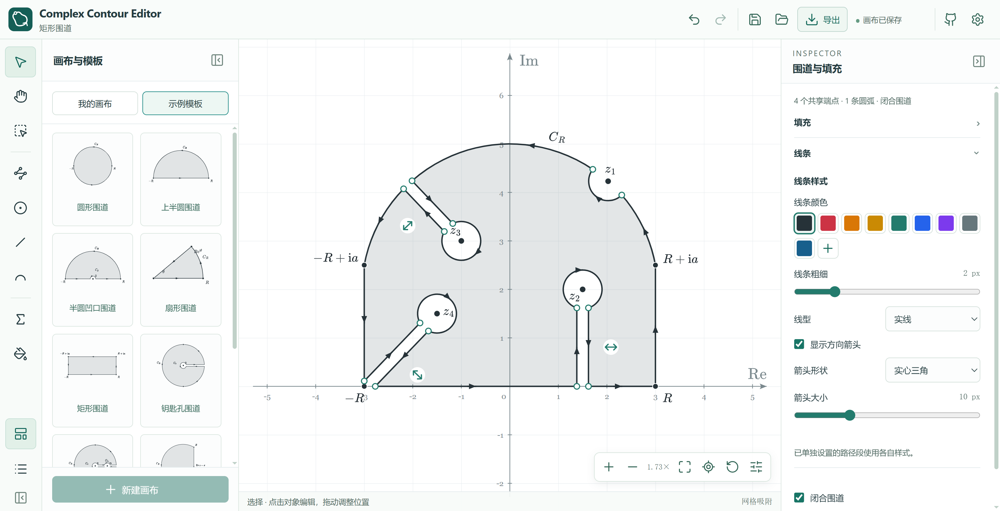
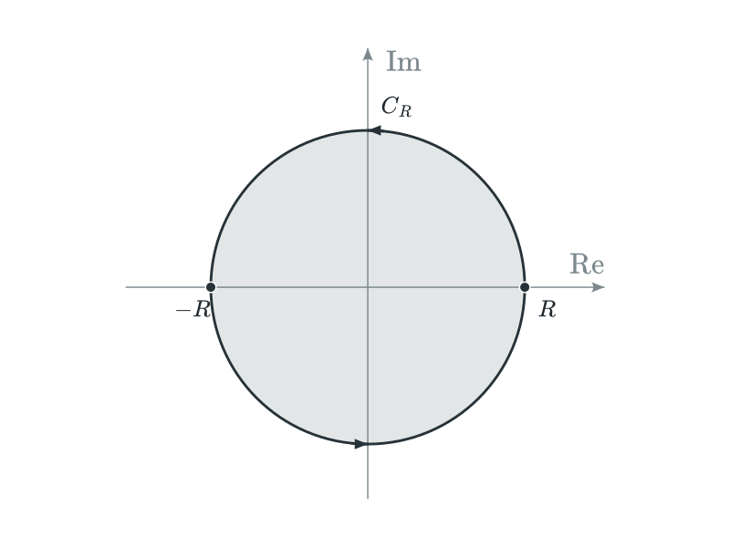
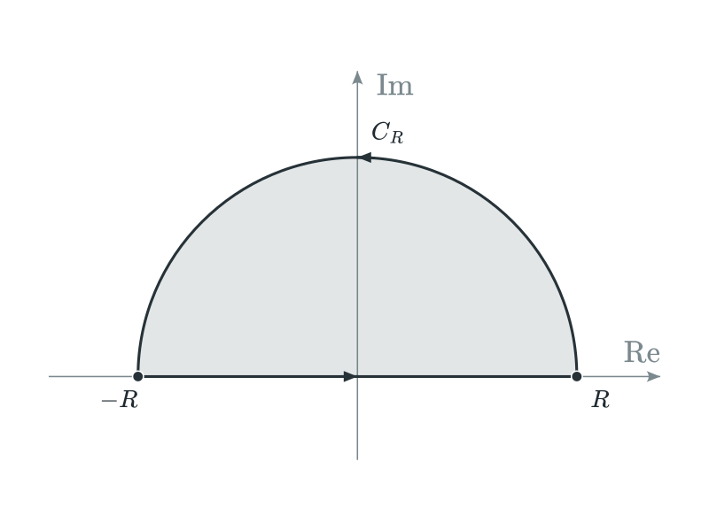
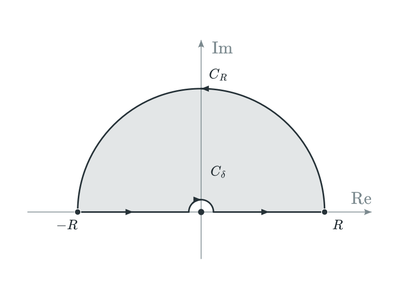
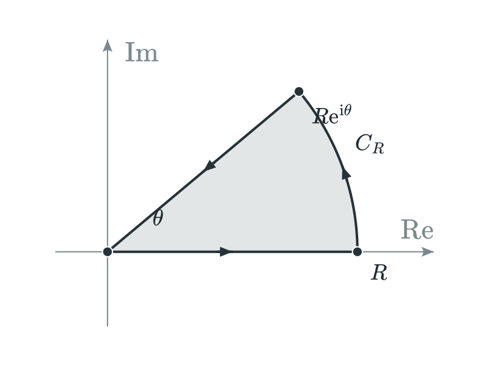
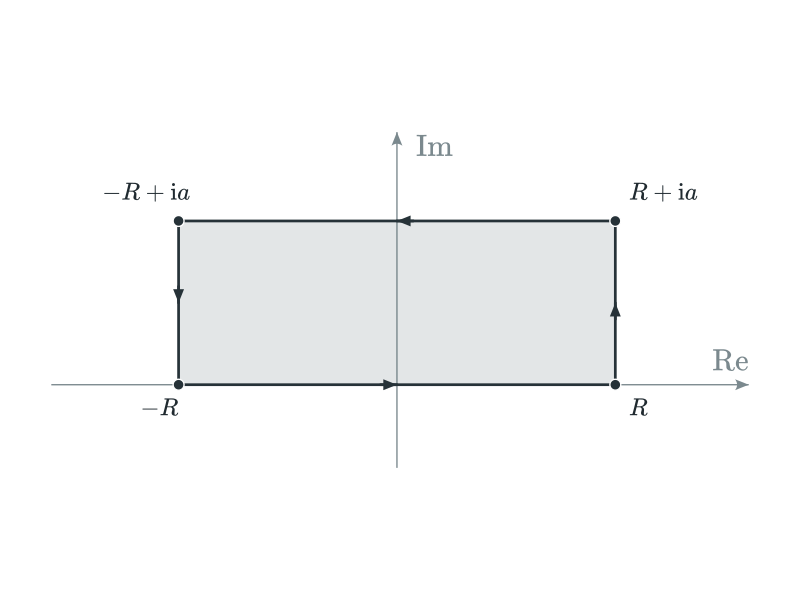
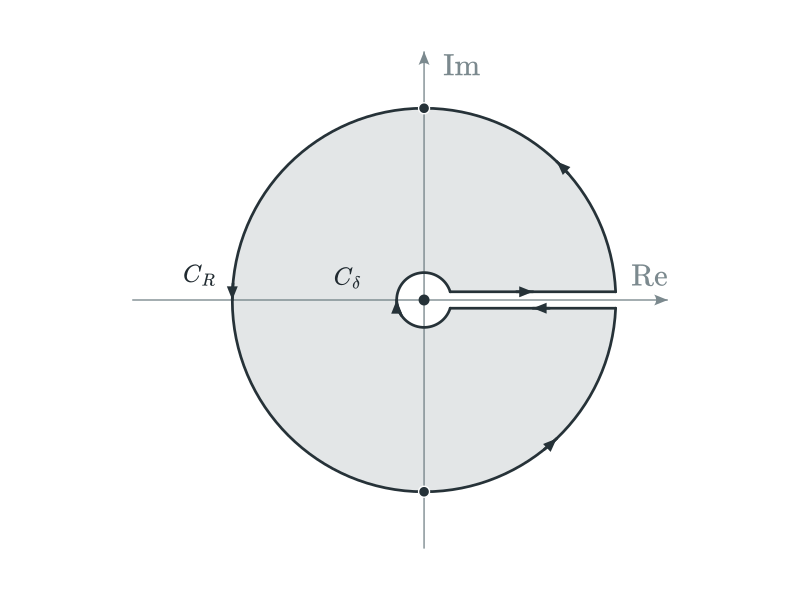
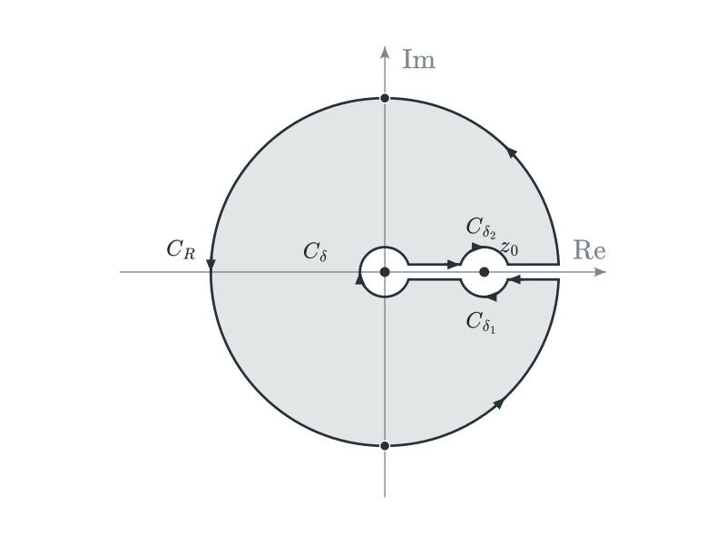
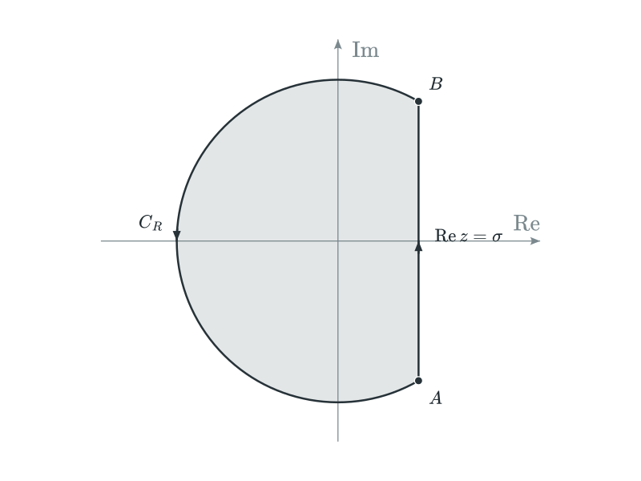
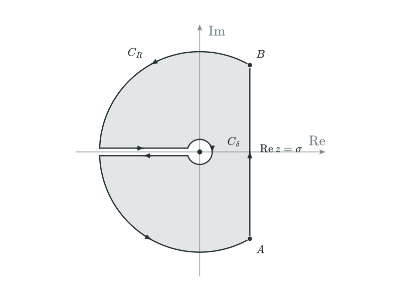

#  Complex Contour Editor

[![React 19.3.1][react-img]][react-url] [![TypeScript 6.0.3][typescript-img]][typescript-url] [![Vite 8.3.4][vite-img]][vite-url] [![MathJax 4.1.3][mathjax-img]][mathjax-url] [![Node.js >=22.12.0][node-img]][node-url]

Complex Contour Editor 是一款在浏览器中使用的复平面围道编辑器，用于绘制由线段与圆弧组成的积分路径。你可以拖动端点或输入坐标来调整图形，为奇点和支点构造绕行，导出用于笔记、讲义和文章的插图。

**[在线使用](https://huanyushi.github.io/contour-editor/)** · [问题反馈](https://github.com/huanyushi/contour-editor/issues)

打开网页即可开始绘图，无需安装软件或配置环境。

左侧用于选择绘图工具、画布和模板，中央是可直接操作的绘图区；选中对象后，便可在右侧调整它的几何参数、外观与标签。



## 主要功能

- **围道绘制**：用线段与三点圆弧组合开放路径或闭合围道，通过拖动或输入坐标调整图形。
- **奇点绕行**：为孤立奇点和支点构造局部绕行或平行连接绕行，调整半径与朝向，并随奇点位置联动更新。
- **标注与外观**：添加 LaTeX 标签和独立公式，自定义线型、方向箭头、点样式及区域填充。
- **模板与画布**：内置常见围道模板，最多管理 10 张独立画布，方便复用和比较不同方案。
- **编辑辅助**：支持多选、批量修改和撤销／重做，便于反复调整图形。

绕行与割线的构造依赖于指定的几何关系，但用户也可自行调整。

## 快速开始

1. 打开[在线编辑器](https://huanyushi.github.io/contour-editor/)，在“示例模板”中选择模板并点击“新建画布”，或新建空白画布。
2. 绘制或调整路径，按需添加奇点绕行、数学标签与区域填充。
3. 完成后，保存项目以便继续编辑，或导出图片用于笔记、讲义和文章。

## 围道模板

|                 圆形围道                 |                   上半圆围道                   |                       半圆凹口围道                        |
| :--------------------------------------: | :--------------------------------------------: | :-------------------------------------------------------: |
|  |  |  |

|                 扇形围道                 |                  矩形围道                   |                 钥匙孔围道                  |
| :--------------------------------------: | :-----------------------------------------: | :-----------------------------------------: |
|  |  |  |

|                      钥匙孔避让奇点                      |                  Bromwich 围道                  |                      Bromwich 割线围道                       |
| :------------------------------------------------------: | :---------------------------------------------: | :----------------------------------------------------------: |
|  |  |  |

示例模板参考了[围道示例 PDF](https://github.com/huanyushi/pdf-study-notes/blob/main/latex/tikz-example-contour-integration.pdf)。

## 保存与导出

作品可以保存为项目文件，也可以导出为图片：

- **JSON**：保存当前画布的可编辑项目，便于备份或跨设备继续编辑。
- **SVG**：保留矢量路径与数学字形，适合缩放和排版。
- **PNG**：便于直接插入文档或分享，提供 1×、2× 和 3× 分辨率倍率。

图片可选白色或透明背景，默认完整导出图形与标签，也可按当前视图导出。

画布会自动保存在当前浏览器中；清理网站数据或更换浏览器、设备后无法从中恢复，重要作品请下载 JSON 备份。

## 本地开发

如果希望在本地运行或继续开发，需先安装 Git 和 Node.js **22.12 或更高版本**。项目基于 React、TypeScript 和 Vite，以原生 SVG 绘图，使用 MathJax 排版数学公式。

获取代码后，安装依赖并启动开发服务器：

```bash
git clone https://github.com/huanyushi/contour-editor.git
cd contour-editor
npm ci
npm run dev
```

启动后，按终端提示访问开发服务器，通常为 <http://localhost:5173/contour-editor/>。

需要构建生产版本并在本地预览时，运行：

```bash
npm run build
npm run preview
```

构建产物位于 `dist/`；预览启动后，按终端提示访问本地地址。

## 许可与开发说明

本项目采用 [MIT 许可证](LICENSE)，第三方依赖与资源遵循各自的许可证。

本项目由作者使用 OpenAI GPT-6.1-SOL 辅助开发。

<!-- 依赖版本取自 package-lock.json，更新依赖时请同步调整徽章；Node.js 标注最低版本要求。 -->

[react-img]: https://img.shields.io/badge/React-19.3.1-61DAFB?style=flat-square
[react-url]: https://react.dev/
[typescript-img]: https://img.shields.io/badge/TypeScript-6.0.3-3178C6?style=flat-square
[typescript-url]: https://www.typescriptlang.org/
[vite-img]: https://img.shields.io/badge/Vite-8.3.4-646CFF?style=flat-square
[vite-url]: https://vite.dev/
[mathjax-img]: https://img.shields.io/badge/MathJax-4.1.3-B5C83C?style=flat-square
[mathjax-url]: https://www.mathjax.org/
[node-img]: https://img.shields.io/badge/Node.js-%3E%3D22.12.0-43853D?style=flat-square
[node-url]: https://nodejs.org/
